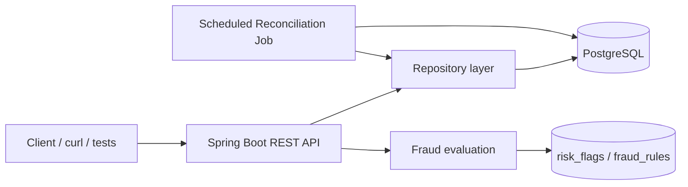

# Digital Wallet Ledger Backend

## A. Project overview

This repository contains a Spring Boot + JDBC PostgreSQL implementation of a digital wallet backend for an Indian rupee wallet. The service models user wallets, system cash-in/cash-out accounts, peer transfers, withdrawals, reversals, an audit trail, fraud rules, and a reconciliation job.

### Problems it solves
- Prevents wallet balance drift during concurrent transfers.
- Maintains complete double-entry accounting for each financial event.
- Supports idempotent retries for the same user request.
- Allows manual review of held or flagged transfers.
- Provides reconciliation reports for ledger and balance inconsistencies.

### Implemented features
- User creation and wallet creation.
- Wallet balance lookup.
- Top-up and withdrawal operations using system accounts.
- Peer transfer with validation and negative-balance protection.
- Reversal of completed transfers.
- Idempotency key tracking for duplicate requests.
- Double-entry ledger updates and audit rows.
- Fraud rule evaluation with HOLD/FLAG outcomes.
- Admin risk queue and transfer decisions.
- Reconciliation run / issue reporting with job locking.
- Wallet statements with pagination.

### Technology stack
- Java 17
- Spring Boot 3.x (project POM uses Spring Boot starter parent)
- Spring Web MVC and Spring JDBC
- PostgreSQL 15-compatible schema
- Maven wrapper (`mvnw` / `mvnw.cmd` present)
- Plain SQL with `JdbcTemplate`/`DataSource` rather than JPA/Hibernate

## B. Architecture overview

The application is a thin REST layer over a PostgreSQL database. The client sends HTTP requests to the Spring Boot service; business logic executes in `service` classes, and SQL is written to the database through repository classes. Wallet balances and ledger entries are updated in the same transaction to preserve consistency.



### Main components
- `controller/`: REST endpoints for users, wallets, transfers, statements, and admin controls.
- `service/`: transactional business logic for wallet operations, reversals, fraud checks, statements, and reconciliation.
- `repository/`: SQL queries using `JdbcTemplate` / `DataSource` for accounts, transfers, ledger, idempotency, risk, and reconciliation data.
- `model/` and `dto/`: record-based domain objects and API request/response structures.
- `job/`: scheduled reconciliation job.
- `src/main/resources/application.properties`: database connection and server config.
- SQL files in the repo root: schema, indices, fraud rules, reconciliation support.

## C. Prerequisites

Required software and versions observed in the project:
- Java 17
- Maven 3.x or the included Maven wrapper (`mvnw` / `mvnw.cmd`)
- PostgreSQL 15 (the repository and SQL defaults assume a local PostgreSQL server on port 5433)
- Docker (for the project’s manual DB bootstrap workflow)

Docker and Compose notes:
- No `docker-compose.yml` file was found in the repository.
- No `Dockerfile` was found in the application project.
- The project uses the manual container command shown in `TransferDataFile.txt` rather than a Compose stack.

## D. Installation and execution

### Clone and enter the project
```bash
git clone <repo-url>
cd <repo-root>
cd PaymentsWalletLedger
```

### Create or configure the database
The application does not use an environment-variable based config for the database; it is configured via `src/main/resources/application.properties`.

Start PostgreSQL manually:
```bash
docker run --name wallet-db-proj -e POSTGRES_PASSWORD=pass -p 5433:5432 -d postgres:15
```

Initialize the schema:
```bash
cd ..
docker exec -i wallet-db-proj psql -U postgres -d postgres < createquery.sql
docker exec -i wallet-db-proj psql -U postgres -d postgres < fraud_rules.sql
docker exec -i wallet-db-proj psql -U postgres -d postgres < IndexTriggers.sql
docker exec -i wallet-db-proj psql -U postgres -d postgres < reconciliation_support.sql
```

### Start the Spring Boot app
From the project directory:
```bash
./mvnw spring-boot:run
```
Or on Windows:
```powershell
mvnw.cmd spring-boot:run
```

The app listens on port 8080 by default.

### Check service status and health
The project does not expose a Spring Boot actuator health endpoint or a custom `/health` route. The practical service check is to hit a real API endpoint, for example:
```bash
curl http://localhost:8080/users/1
```
Or list wallets:
```bash
curl http://localhost:8080/users/1/wallets
```

### View logs
- For the database: `docker logs wallet-db-proj`
- For the app: output from the terminal running `spring-boot:run`

### Stop the application
- Stop the Spring Boot process with `Ctrl+C` in the terminal running it.
- Stop the database container:
```bash
docker stop wallet-db-proj
docker rm wallet-db-proj
```

### Run automated tests
From `PaymentsWalletLedger/`:
```bash
./mvnw test
```
This runs the integration-style API tests under `src/test/java`.

### Seed-data process
There is no seed-data application or mass data generator in the repo. The project includes SQL schema files and one `TransferDataFile.txt` guide for manual database setup. The assignment target of 1,000 users / 2,000 wallets / 100,000 transfers is not supported by a verified seed script in this repository state.

## E. Environment variables

The application’s database configuration is not yet externalized via environment variables in the repository. The effective database settings live in `src/main/resources/application.properties`:

| Variable | Purpose | Example value |
|---|---|---|
| `spring.datasource.url` | PostgreSQL connection string | `jdbc:postgresql://localhost:5433/postgres` |
| `spring.datasource.username` | Database user | `postgres` |
| `spring.datasource.password` | Database password | `change-me` |
| `server.port` | HTTP port | `8080` |
| `spring.datasource.hikari.data-source-properties.options` | JDBC options, including timezone | `-c TimeZone=Asia/Kolkata` |

Example `application.properties` snippet:
```properties
spring.application.name=PaymentsWalletLedger
spring.datasource.url=jdbc:postgresql://localhost:5433/postgres
spring.datasource.username=postgres
spring.datasource.password=change-me
server.port=8080
spring.datasource.hikari.data-source-properties.options=-c TimeZone=Asia/Kolkata
```

No actual password is included in this repository documentation.

## F. API documentation

The service is a direct REST layer without authentication middleware. No auth requirement is implemented in the controller code.

| Method | Endpoint | Purpose | Auth | Notes |
|---|---|---|---|---|
| `POST` | `/users` | Create a user | None | Body: `name`, `email`, `phone` |
| `GET` | `/users/{id}` | Fetch one user | None | Returns `User` |
| `POST` | `/users/{userId}/wallets` | Create a wallet for a user | None | Body: `walletType` (`MAIN` or `SAVING`) |
| `GET` | `/users/{userId}/wallets` | List wallets for a user | None | Returns array |
| `GET` | `/wallets/{walletId}/balance` | Get wallet balance | None | Returns paise + rupees |
| `POST` | `/transfers/topup` | Top-up a user wallet | None | Requires `Idempotency-Key` |
| `POST` | `/transfers` | Peer transfer | None | Requires `Idempotency-Key` |
| `POST` | `/transfers/withdraw` | Withdraw to cash-out | None | Requires `Idempotency-Key` |
| `POST` | `/transfers/{id}/reverse` | Reverse a transfer | None | Requires `Idempotency-Key` |
| `GET` | `/transfers/{id}` | Fetch transfer and ledger detail | None | Returns transfer + ledger + audit references |
| `GET` | `/wallets/{walletId}/statement` | Paginated wallet ledger statement | None | Query params `limit`, `offset` |
| `POST` | `/admin/reconciliation/run` | Run reconciliation | None | Returns 202 + report metadata |
| `GET` | `/admin/reconciliation/runs/{id}` | Read one reconciliation report | None | Returns issues and run summary |
| `GET` | `/admin/risk/queue` | View held/flagged transfers | None | Uses `limit` and `offset` |
| `POST` | `/admin/risk/{transferId}/decision` | Admin decision on a held transfer | None | Body: `decision`, `reason`, `adminUserId` |

### Representative request/response examples

Create user:
```http
POST /users
Content-Type: application/json

{"name":"Alice","email":"alice@example.com","phone":"9999999999"}
```

Example response:
```json
{
  "id": 1,
  "name": "Alice",
  "email": "alice@example.com",
  "phone": "9999999999",
  "kycStatus": "PENDING"
}
```

Create wallet:
```http
POST /users/1/wallets
Content-Type: application/json

{"walletType":"MAIN"}
```

Peer transfer:
```http
POST /transfers
Idempotency-Key: 550e8400-e29b-41d4-a716-446655440000
Content-Type: application/json

{"fromWalletId":1,"toWalletId":2,"amountPaise":1000,"note":"rent"}
```

Successful transfer response:
```json
{
  "transferId": 42,
  "status": "COMPLETED",
  "transferType": "PEER_TRANSFER",
  "amountPaise": 1000,
  "amountRupees": "₹10.00",
  "originalTransferId": null,
  "note": "rent",
  "createdAt": "2026-10-24T12:34:56Z"
}
```

Statement request:
```http
GET /wallets/1/statement?limit=20&offset=0
```

Statement response shape:
```json
{
  "walletId": 1,
  "limit": 20,
  "offset": 0,
  "count": 2,
  "entries": [
    {
      "transferId": 24,
      "transferType": "TOP_UP",
      "status": "COMPLETED",
      "direction": "CREDIT",
      "amountPaise": 1500,
      "note": "bonus",
      "createdAt": "2026-10-24T12:00:00Z"
    }
  ]
}
```

### Important error responses
- Invalid JSON / missing body: `400` with `BAD_REQUEST`.
- Unknown user/wallet or wrong system account: `404` or `422` depending on the operation.
- Insufficient balance or invalid request shape: `422`.
- Duplicate idempotent request with different payload: `422`.
- Duplicate wallet type for the same user: `409`.

## G. Database initialization and seed data

The project does not use Flyway or Liquibase. The database is initialized by running SQL files manually against a PostgreSQL instance.

### Files used for initialization
- `createquery.sql`: creates the schema.
- `fraud_rules.sql`: inserts the default fraud rules and indexes.
- `IndexTriggers.sql`: creates indexes and ledger safety trigger(s).
- `reconciliation_support.sql`: inserts the reconciliation job lock and adjusts issue-type constraints.
- `backup_create_query.sql`: backup of the main schema.

### How the schema is created
```bash
docker exec -i wallet-db-proj psql -U postgres -d postgres < createquery.sql
```

### Initial system accounts
The `accounts` table creates system-level rows for:
- `CASH_IN`
- `CASH_OUT`
- `FEE_REVENUE`

These are used to model top-ups, withdrawals, and fee accounting.

### Seed dataset targets
The assignment mentions a target of:
- 1,000 users
- 2,000 wallets
- 100,000 transfers

This repository does not contain a verified seed script or generator that creates those counts. The `TransferDataFile.txt` and SQL scripts bootstrap the schema and check constraints but do not appear to generate a full large dataset. As of the checked-in code, these target counts are design goals, not confirmed loaded data.

## H. Financial correctness and business rules

### Integer paise representation and INR
The system stores all money values in paise as `BIGINT` and keeps `currency` fixed to `INR`. This matches the database check constraint `CHECK (currency = 'INR')` and the `Money` utility conversion helper.

### User wallets and system accounts
- `accounts.account_type` is either `USER_WALLET` or `SYSTEM`.
- `USER_WALLET` rows require a `user_id`, `wallet_type`, and null `system_account_code`.
- `SYSTEM` rows require `system_account_code` and null `user_id` / `wallet_type`.
- `wallet_type` is `MAIN` or `SAVING`, and each user may have at most one wallet of each type.

### Double-entry ledger
Every non-held transfer writes balanced entries into `ledger_entries`:
- one or more `DEBIT` rows
- one or more `CREDIT` rows
- the sum of debits equals the sum of credits inside the same transaction

This is enforced in `TransferService` before the transaction commits.

### Debit and credit balancing
The code explicitly rejects unbalanced books with an exception if debits and credits are not equal. This makes each transfer self-balancing, even when system accounts are involved.

### Atomic balance updates and ledger writes
The transfer path uses a single JDBC transaction. The code locks account rows with `SELECT ... FOR UPDATE` and then updates both account balances and ledger entries inside the same connection. If any part of the write fails, the transaction is rolled back.

### Prevention of negative user-wallet balances
`accounts` has `chk_no_overdraft CHECK (account_type = 'SYSTEM' OR balance_paise >= 0)`, and the transfer service performs a second validation against the lock-held account state before it writes. User wallets cannot go negative.

### Transfer statuses and reversal handling
Valid statuses are `PENDING`, `COMPLETED`, `HELD`, and `FAILED`.
- A transfer may be `HELD` if fraud rules fire with `HOLD` action.
- `REVERSAL` is a transfer type that references `original_transfer_id`.
- A reversal cannot reverse another reversal.
- Reversal is implemented by creating a new transfer row with `transfer_type='REVERSAL'` and applying the inverse financial effect.

### Idempotency keys and duplicate-request behavior
`idempotency_keys` tracks `user_id + idempotency_key` with a unique constraint and also stores a SHA-256 `request_hash`.
- Same key + same body returns the original response.
- Same key + different body returns HTTP `422`.
- Same key retried after a failed attempt may be retried once the original cause is resolved, subject to the service logic.

### Audit history
Every important status change is written to `audit_logs`, including the old/new status, changed-by user or system actor, and the reason.

### Fraud flags and held transfers
Default rules are inserted by `fraud_rules.sql`:
- `HIGH_AMOUNT_HOLD`: hold a transfer when amount exceeds a threshold.
- `VELOCITY_FLAG`: flag high-frequency debits within a time window.

Risk decisions are stored in `risk_flags` and admin decisions can release, dismiss, or reverse a flagged transfer.

### Reconciliation and reported issues
`ReconciliationService.run()` executes multiple checks:
1. Global ledger balance mismatch
2. Transfer balance mismatch
3. Stored balance mismatch
4. Overdraft/inconsistent balances
5a. Transfer rows without ledger entries
5b. Ledger entries without transfer rows

The job is protected by `job_locks` and a `NOWAIT` select to avoid concurrent reconciliation runs. The results are stored in `reconciliation_runs` and `reconciliation_issues`.

### Statement pagination
`GET /wallets/{walletId}/statement` supports `limit` and `offset`, with a default limit of 20 and a max of 100. Negative offsets and zero/negative limits return `400`.

## I. Design assumptions and decisions

### 1. Use of paise instead of decimal currency
- Decision: store all money as integer paise.
- Why: avoids floating-point error in financial accounting.
- Implemented in: `BIGINT` columns, `Money` utility, transfer and ledger calculations.
- Implication: all values must be passed and displayed in paise; user-facing conversion is done in the API layer.

### 2. Use of a direct SQL JDBC repository layer
- Decision: prefer explicit SQL over JPA.
- Why: the assignment emphasizes transactional control, locking, and ledger correctness.
- Implemented in: repository classes and the `DataSource`-managed transactions.
- Implication: more verbose SQL, but better visibility into locking and reconciliation logic.

### 3. Separate account types for system and user wallets
- Decision: `accounts` distinguishes role by `account_type` and `system_account_code` / `wallet_type`.
- Why: system accounts must be able to float while user wallets cannot overdraft.
- Implemented in: database CHECK constraints and runtime service validation.
- Implication: there is a clean split between user balances and operational accounts.

### 4. Fraud rules are evaluated before commit
- Decision: evaluate rules and generate `risk_flags` inside the same transfer transaction.
- Why: the transfer should either be cleanly completed or held; no half-committed state.
- Implemented in: `FraudService` plus `TransferService` transaction boundary.
- Limitation: the actual ML/LLM scoring concept is not implemented at the repo level; the code uses simple amount/velocity rules.

### 5. Reconciliation is a reporting job, not an automatic repair job
- Decision: reconciliation detects issues and records them without modifying live balances automatically.
- Why: the assignment expects issue detection and admin action, not silent repair.
- Implemented in: `ReconciliationService` and `reconciliation_issues` table.
- Limitation: no auto-fix path is in the checked-in code.

## J. Testing

The repo contains these test classes under `PaymentsWalletLedger/src/test/java/com/digitalwallet/PaymentsWalletLedger/`:
- `WalletApiTest.java`
- `UserApiTest.java`
- `BalanceApiTest.java`
- `TransferApiTest.java`
- `IdempotencyApiTest.java`
- `RiskApiTest.java`
- `StatementApiTest.java`
- `ReconciliationApiTest.java`
- `PaymentsWalletLedgerApplicationTests.java`

### Test command
```bash
cd PaymentsWalletLedger
./mvnw test
```

### Acceptance scenarios and existence
| Scenario | Status |
|---|---|
| 100 concurrent outgoing transfers of ₹10 from a wallet containing ₹500: exactly 50 should succeed, final balance zero, no negative balance | Implemented in `TransferApiTest` (`100 parallel Rs10 transfers from a Rs500 wallet: exactly 50 succeed`) |
| Repeating the same idempotent request five times produces one transfer and identical responses | Implemented in `IdempotencyApiTest` |
| Ten parallel retries with the same idempotency key produce one transfer | Implemented in `IdempotencyApiTest` (`Same key sent 10 times in parallel: exactly 1 transfer`) |
| Reusing the same idempotency key with a different request body returns HTTP 422 | Implemented in `IdempotencyApiTest` (`Same key with a different amount returns 422 and no money moves`) |
| Reconciliation detects introduced inconsistencies | Implemented in `ReconciliationApiTest` |
| Statement pagination and query performance checks | Implemented in `StatementApiTest` |

Measured results are only available when the project is run locally; no test output was captured in this repository snapshot. The points above reflect the assertions present in the checked-in tests, not fabricated benchmark numbers.

## K. Known limitations and future improvements

### Implemented features
- User and wallet lifecycle management
- Transfer workflow with ledger and balance checks
- Reversal and idempotency
- Fraud rules and admin decisions
- Reconciliation reporting and job locking
- Statement pagination

### Partially implemented features
- Some rule logic is intentionally simple: high-amount and velocity rules are implemented, but no advanced ML or scoring pipeline is wired in.
- Admin risk actions exist, but there is no external identity or authentication layer.
- The repo has SQL scripts but no migration tooling or automated bootstrap for large-scale dataset generation.

### Missing requirements
- No system authentication or authorization flow was found.
- No Docker Compose startup stack or production-ready environment configuration.
- No actuator health endpoint or central observability stack was identified.
- No verified seed-data generator for the assignment’s 1,000 / 2,000 / 100,000 target dataset.

### Future production improvements
- Move configuration to environment variables or a secret manager.
- Add request validation library and schema validation.
- Add a true health endpoint and scheduled metrics.
- Introduce migration tooling (Flyway/Liquibase) for versioned schema changes.
- Add background workers or queueing for reconciliation and fraud review.

## L. Demo instructions

Suggested five-minute demo sequence:
1. Start the database and application.
2. Create a user and wallet, then perform a successful peer transfer and show the ledger entries via `/transfers/{id}`.
3. Retry the same transfer with the same `Idempotency-Key` and show identical response payloads.
4. Trigger a fraud rule (high-amount or velocity) and show the held transfer under `/admin/risk/queue`.
5. Run `/admin/reconciliation/run` to generate a report and show the issue list.

The LLM statement Q&A demo is intentionally excluded because it is not implemented in this repo.

## Appendix: quick command summary

```bash
# DB
 docker run --name wallet-db-proj -e POSTGRES_PASSWORD=pass -p 5433:5432 -d postgres:15
 docker exec -i wallet-db-proj psql -U postgres -d postgres < createquery.sql
 docker exec -i wallet-db-proj psql -U postgres -d postgres < fraud_rules.sql
 docker exec -i wallet-db-proj psql -U postgres -d postgres < IndexTriggers.sql
 docker exec -i wallet-db-proj psql -U postgres -d postgres < reconciliation_support.sql

# APP
 cd PaymentsWalletLedger
 ./mvnw spring-boot:run

# TESTS
 ./mvnw test
```
